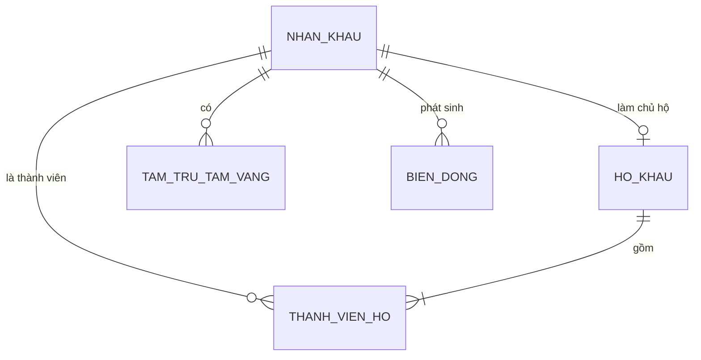

# Thiết kế cơ sở dữ liệu và lý do lựa chọn

Tài liệu trình bày thiết kế CSDL quản lý nhân khẩu trên hai hệ quản trị, MySQL 8.0 (quan hệ) và MongoDB 8.0 (document), cùng lý do của từng lựa chọn. Nghiệp vụ và quy tắc (NV01–NV10) được mô tả trong [NGHIEP_VU_QUAN_LY_NHAN_KHAU.md](NGHIEP_VU_QUAN_LY_NHAN_KHAU.md).

## 1. Mục tiêu thiết kế

1. **Đúng nghiệp vụ:** thể hiện được công dân, hộ gia đình, quan hệ với chủ hộ, tạm trú/tạm vắng và lịch sử biến động.
2. **Mỗi hệ được thiết kế theo đúng thế mạnh của nó.** MySQL dùng thiết kế chuẩn hóa. MongoDB dùng thiết kế hướng truy vấn (nhúng ở chỗ hợp lý). Nếu ép MongoDB dùng y hệt lược đồ quan hệ, phép so sánh sẽ thiệt cho MongoDB và không phản ánh cách hệ này được dùng trong thực tế.
3. **So sánh được với nhau:** hai bên chứa cùng một tập dữ liệu (nạp từ cùng các file CSV), có cùng khóa logic (`id` của MySQL là `_id` của MongoDB) và các index tương đương nhau.

## 2. Mô hình thực thể - liên kết



- **Nhân khẩu ↔ Hộ** là quan hệ nhiều-nhiều *theo thời gian*: một người có thể chuyển qua nhiều hộ trong đời, nhưng mỗi thời điểm chỉ thuộc một hộ (NV03). Vì vậy quan hệ này được tách thành thực thể riêng `THANH_VIEN_HO`, có thuộc tính `quan_he`, `tu_ngay`, `den_ngay`.
- **Chủ hộ** là một liên kết riêng từ hộ tới nhân khẩu (NV04).
- **Tạm trú/tạm vắng** và **biến động** là quan hệ một-nhiều từ nhân khẩu.

## 3. Thiết kế MySQL (quan hệ, chuẩn hóa)

File: `01_schema_mysql.sql`. Gồm 5 bảng, đạt dạng chuẩn 3 (3NF), riêng `ho_khau.chu_ho_id` là một ngoại lệ có chủ đích (xem 3.3).

| Bảng | Khóa chính | Khóa/Index khác | Vai trò |
|---|---|---|---|
| `nhan_khau` | `id` | `UNIQUE(cccd)` | Hồ sơ công dân |
| `ho_khau` | `id` | `UNIQUE(ma_ho)`, FK `chu_ho_id` | Hộ gia đình |
| `thanh_vien_ho` | `id` | `UNIQUE(ho_khau_id, nhan_khau_id)`, index `nhan_khau_id` | Ai thuộc hộ nào, quan hệ gì, từ ngày nào đến ngày nào |
| `tam_tru_tam_vang` | `id` | index `(nhan_khau_id, tu_ngay)` | Hồ sơ tạm trú và tạm vắng |
| `bien_dong` | `id` | index `(nhan_khau_id, ngay_bien_dong)` | Nhật ký biến động |

### 3.1. Lý do tách bảng

- **Tách `thanh_vien_ho` thay vì đặt `ho_khau_id` trong `nhan_khau`.** Nếu chỉ có một cột `ho_khau_id` thì mỗi lần chuyển hộ, dữ liệu cũ bị ghi đè và mất lịch sử, trái NV08. Bảng trung gian có `tu_ngay`/`den_ngay` giữ được toàn bộ lịch sử. Nơi thường trú hiện tại là bản ghi có `den_ngay IS NULL`.
- **Gộp tạm trú và tạm vắng vào một bảng**, phân biệt bằng `loai` (ENUM). Hai loại hồ sơ có cùng cấu trúc (người, địa chỉ liên quan, khoảng thời gian, lý do, trạng thái) và thường được tra cứu cùng nhau trong hồ sơ một người. Tách thành 2 bảng chỉ làm tăng số phép JOIN.
- **Tách `bien_dong`.** Đây là nhật ký chỉ thêm mới và tăng liên tục theo thời gian. Để riêng thì bảng `nhan_khau` luôn gọn, các truy vấn hồ sơ không phải đọc cả lịch sử.

### 3.2. Kiểu dữ liệu

| Cột | Kiểu | Lý do |
|---|---|---|
| `cccd` | `CHAR(12)` | Luôn đủ 12 ký tự. Phải là chuỗi để giữ số 0 ở đầu (mã tỉnh Hà Nội là 001). Nếu lưu dạng số, `001...` sẽ mất 2 số 0 đầu |
| `gioi_tinh`, `quan_he`, `loai`, `trang_thai`, `loai_bien_dong` | `ENUM` | Tập giá trị cố định do nghiệp vụ quy định. ENUM chỉ tốn 1–2 byte và tự từ chối giá trị lạ |
| Các ngày | `DATE` | Chỉ cần ngày, không cần giờ |
| Chuỗi | `VARCHAR`, bộ mã `utf8mb4` | Hỗ trợ đầy đủ tiếng Việt có dấu (dữ liệu thử hiện không dấu, nhưng schema đã sẵn sàng) |
| Khóa | `INT AUTO_INCREMENT` | Khóa ngắn và tăng dần, phù hợp với cách InnoDB tổ chức dữ liệu theo khóa chính (clustered index), nên chèn nhanh và không bị phân mảnh |

### 3.3. Ràng buộc toàn vẹn

- `ho_khau.chu_ho_id` → `nhan_khau.id` với `ON DELETE RESTRICT`: không cho xóa người đang là chủ hộ, phải đổi chủ hộ trước (NV04).
- Các bảng con (`thanh_vien_ho`, `tam_tru_tam_vang`, `bien_dong`) dùng `ON DELETE CASCADE`: xóa một nhân khẩu thì các bản ghi phụ thuộc cũng bị xóa theo.
- **`chu_ho_id` là dữ liệu dư thừa có chủ đích.** Thông tin chủ hộ có thể suy ra từ `thanh_vien_ho.quan_he = 'Chu ho'`. Lưu thêm `chu_ho_id` giúp tra chủ hộ không cần JOIN và cho phép dùng khóa ngoại để chặn việc xóa chủ hộ. Đổi lại, khi đổi chủ hộ phải cập nhật cả hai nơi trong cùng một transaction.

### 3.4. Index

- **Index cơ bản (luôn có):** khóa chính, các UNIQUE và các index trên cột khóa ngoại. Đây là mức tối thiểu cho tính đúng và cho JOIN.
- **Index phụ (bật/tắt trong benchmark):** `nhan_khau(ho_ten)`, `nhan_khau(que_quan)`, `tam_tru_tam_vang(trang_thai, loai)`. Các index này phục vụ tìm kiếm theo tên và thống kê tạm trú. Benchmark đo cả khi có và không có chúng để thấy rõ tác dụng của index.
- Index ghép `(nhan_khau_id, ngay_bien_dong)` vừa dùng để lọc theo người vừa trả kết quả đã sắp theo ngày, nên MySQL không phải sắp xếp thêm khi xem lịch sử biến động.

## 4. Thiết kế MongoDB (document, hướng truy vấn)

File: `04_load_mongodb.py`. Gồm 3 collection.

### 4.1. Nguyên tắc nhúng (embed) hay tham chiếu (reference)

| Tiêu chí | Nhúng khi... | Tham chiếu khi... |
|---|---|---|
| Cách đọc | Dữ liệu con hầu như luôn được đọc cùng dữ liệu cha | Dữ liệu con thường được đọc riêng |
| Số lượng | Quan hệ một-ít (vài phần tử) và có giới hạn | Quan hệ một-nhiều không giới hạn |
| Thay đổi | Dữ liệu con ít thay đổi | Dữ liệu con thay đổi thường xuyên hoặc được nhiều nơi dùng chung |
| Giới hạn kỹ thuật | Document vẫn nhỏ hơn nhiều so với giới hạn 16 MB | Có nguy cơ vượt 16 MB |

### 4.2. Ba collection

**`citizens`**: một document cho mỗi nhân khẩu, `_id` bằng `id` của MySQL.

```json
{
  "_id": 10,
  "cccd": "056152000012",
  "ho_ten": "Huynh Bao Dung",
  "ngay_sinh": {"$date": "1952-05-09"},
  "gioi_tinh": "Nam",
  "que_quan": "Khanh Hoa",
  "nghe_nghiep": "Nghi huu",
  "ngay_dang_ky": {"$date": "2016-10-14"},
  "ho_khau": {"ho_khau_id": 10, "quan_he": "Chu ho", "tu_ngay": {"$date": "1991-01-06"}},
  "tam_tru_tam_vang": [
    {"id": 1, "loai": "Tam tru", "dia_chi_lien_quan": "So 10 Duong Ha Noi, Ha Noi",
     "tu_ngay": {"$date": "2015-04-01"}, "den_ngay": {"$date": "2016-11-05"},
     "ly_do": "Hoc tap", "trang_thai": "Da ket thuc"}
  ]
}
```
*(Ví dụ minh họa cấu trúc. Giá trị cụ thể lấy từ Compass sau khi nạp.)*

- **Nhúng `ho_khau`:** mỗi người chỉ có một nơi thường trú hiện tại, nên một trường đơn (không phải mảng) đã tự bảo đảm NV03. Thông tin này luôn được đọc cùng hồ sơ (R3).
- **Nhúng `tam_tru_tam_vang`:** mỗi người có ít hồ sơ tạm trú/tạm vắng, gần như luôn đọc kèm hồ sơ, và hồ sơ đã kết thúc thì không đổi nữa. Xem hồ sơ đầy đủ một người chỉ cần đọc một document, không cần JOIN.

**`households`**: một document cho mỗi hộ, `_id` bằng `id` hộ.

```json
{
  "_id": 10, "ma_ho": "HK0000000010", "dia_chi": "So 10 Duong Khanh Hoa, Khanh Hoa",
  "chu_ho_id": 10, "ngay_lap": {"$date": "1991-01-06"},
  "members": [
    {"citizenId": 10,     "cccd": "056152000012", "ho_ten": "Huynh Bao Dung",  "quan_he": "Chu ho"},
    {"citizenId": 250010, "cccd": "...",          "ho_ten": "...",             "quan_he": "Vo chong"}
  ]
}
```

- **Nhúng bản sao rút gọn (snapshot) của thành viên:** xem danh sách thành viên hộ (R4) và in danh sách nhiều hộ (J1) là thao tác rất thường gặp. Có snapshot thì chỉ cần đọc một document, không cần `$lookup`.
- **Cái giá phải trả là dữ liệu bị trùng.** Họ tên và CCCD có cả trong `citizens` lẫn `households.members`. Khi đổi họ tên (W2) phải cập nhật 2 document. Đây là đánh đổi điển hình của thiết kế document: đọc nhanh hơn, ghi tốn hơn, và ứng dụng phải tự giữ cho hai bản sao nhất quán.
- Snapshot chỉ chứa vài trường ít thay đổi, không chứa toàn bộ hồ sơ, để giảm chi phí đồng bộ.

**`population_logs`**: biến động, mỗi sự kiện là một document; tham chiếu tới công dân bằng `nhan_khau_id` và kèm `cccd`.

- **Tham chiếu thay vì nhúng**, vì biến động tăng không giới hạn theo thời gian. Nếu nhúng vào `citizens`, document sẽ phình to mãi, và mỗi lần đọc hồ sơ phải mang theo toàn bộ lịch sử.
- **Lưu kèm `cccd`** (dữ liệu trùng có chủ đích) để tra lịch sử theo CCCD (R5) chỉ cần một truy vấn, không phải tìm `_id` trước.

### 4.3. Hai phương án đã cân nhắc nhưng không chọn

| Phương án | Lý do không chọn |
|---|---|
| **Chuẩn hóa hoàn toàn như MySQL** (5 collection, nối bằng `$lookup`) | Mọi truy vấn hồ sơ hoặc hộ đều cần `$lookup`. Thao tác J2 trong benchmark cho thấy `$lookup` chậm hơn nhiều so với đọc dữ liệu đã nhúng (J1). Thiết kế này không tận dụng được mô hình document |
| **Nhúng toàn bộ công dân vào hộ** (chỉ dùng collection `households`) | Công dân là thực thể độc lập, được tra cứu riêng theo CCCD. Khi một người chuyển hộ, phải chuyển cả hồ sơ sang document khác. Thống kê theo công dân phải `$unwind` toàn bộ dữ liệu |

### 4.4. Index

| Collection | Index | Tương đương MySQL |
|---|---|---|
| `citizens` | `_id` (mặc định), `uq_cccd` (unique), `ix_ho_khau_id` | PK, `UNIQUE(cccd)`, index `thanh_vien_ho.ho_khau_id` |
| `households` | `_id`, `uq_ma_ho` (unique), `ix_chu_ho`, `ix_members_citizen` (multikey, index trên mảng) | PK, `UNIQUE(ma_ho)`, FK `chu_ho_id`, index `thanh_vien_ho.nhan_khau_id` |
| `population_logs` | `_id`, `(nhan_khau_id, ngay_bien_dong)`, `(cccd, ngay_bien_dong)` | PK, `(nhan_khau_id, ngay_bien_dong)` |
| `citizens` (index phụ) | `ho_ten`, `que_quan`, `(tam_tru_tam_vang.trang_thai, tam_tru_tam_vang.loai)` (multikey) | 3 index phụ của MySQL |

Ngày tháng được lưu bằng kiểu **BSON Date**, không phải chuỗi, để so sánh và lọc theo khoảng thời gian đúng ngữ nghĩa.

## 5. Bảng đối chiếu hai thiết kế

| Khía cạnh | MySQL | MongoDB |
|---|---|---|
| Đơn vị lưu trữ | 5 bảng, 2,55 triệu dòng (bộ 1M) | 3 collection, 1,45 triệu document |
| Hồ sơ một người | JOIN 3 bảng + 1 truy vấn tạm trú | Đọc 1 document + 1 document hộ |
| Thành viên một hộ | JOIN 3 bảng | Đọc 1 document |
| Đổi họ tên | Cập nhật 1 dòng | Cập nhật 2 document (do dữ liệu trùng) |
| Toàn vẹn tham chiếu | Khóa ngoại, CASCADE/RESTRICT do hệ quản trị bảo đảm | Không có khóa ngoại, ứng dụng phải tự bảo đảm |
| Transaction nhiều bảng/collection | Có (InnoDB) | Chỉ có khi chạy replica set; máy thử nghiệm chạy standalone nên không có |
| Ràng buộc kiểu dữ liệu | Schema cố định, ENUM, NOT NULL | Schema linh hoạt (có thể bổ sung `$jsonSchema` validator) |

## 6. Điều kiện để phép so sánh công bằng

1. **Cùng dữ liệu:** nạp từ cùng các file CSV. `06_benchmark.py` kiểm tra số bản ghi và đối chiếu một CCCD mẫu trước khi đo.
2. **Cùng logic truy vấn:** mỗi cặp truy vấn trả về cùng số dòng. Script tự cảnh báo nếu hai bên trả về số dòng khác nhau.
3. **Index tương đương:** hai chế độ `no_index` và `with_index` bật/tắt cùng một nhóm index phụ ở cả hai bên.
4. **Cùng bộ nhớ đệm:** mặc định InnoDB buffer pool cấu hình 128 MB, còn WiredTiger cache 7,5 GB trên máy thử nghiệm. Benchmark đặt cả hai bằng 2 GB.
5. **Cùng mức bền vững dữ liệu:** MySQL `innodb_flush_log_at_trx_commit=1` (fsync mỗi lần commit). MongoDB ghi với write concern `j: true` (chờ ghi journal).
6. **Khác biệt còn lại cần nêu khi phân tích kết quả:**
   - Driver: PyMySQL viết thuần Python; PyMongo có phần mở rộng viết bằng C.
   - Thời gian đo là thời gian phía client, gồm cả việc chuyển kết quả về và chuyển đổi kiểu dữ liệu.
   - Khi ghi vào nhiều collection, MongoDB không có transaction bao quanh.
